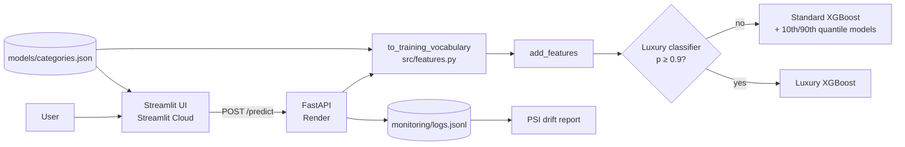
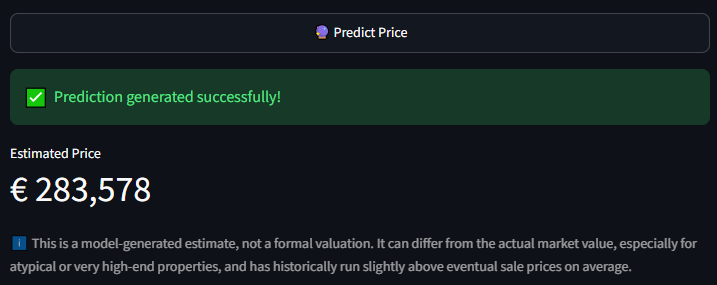
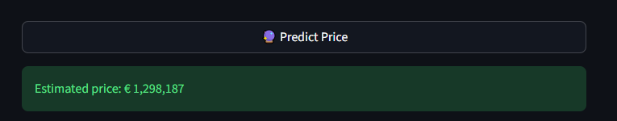

# Immo Eliza Deployment

Deployment phase of the **Immo Eliza Machine Learning** project: a REST API + web interface that predicts Belgian residential property prices, with a dedicated luxury-segment model for high-end properties.

- 🚀 FastAPI backend + 🎨 Streamlit frontend
- 🤖 XGBoost regression, with a luxury-segment model + routing classifier
- ✅ Automated pytest suite (106 tests, API and UI, no network, run in CI)
- 📊 Prediction logging, PSI-based drift detection
- 📏 Headline figures on a sealed test split (2,362 listings) that nothing was fitted, tuned or chosen on
- 🔎 Audited end to end: [14 bugs found and fixed](#bugs-found-and-fixed), including one that made the model ignore property type and province and a luxury model that always answered €1.9M
- 📘 [Technical deep dive](docs/technical_deep_dive.md): how each model, the routing and the price range work, why, and what is still weak

---

## Table of Contents

1. [Project Architecture](#project-architecture)
2. [Bugs Found and Fixed](#bugs-found-and-fixed)
3. [File Purpose](#file-purpose)
4. [Running the Application](#running-the-application)
5. [Reliability & Uptime Monitoring](#reliability--uptime-monitoring)
6. [Using the Application](#using-the-application)
7. [Prediction Examples](#prediction-examples)
8. [Model Performance & Monitoring](#model-performance--monitoring)
9. [Luxury Routing](#luxury-routing)
10. [Known Limitations & Disclaimer](#known-limitations--disclaimer)
11. [Drift Analysis](#drift-analysis)
12. [Automated Testing](#automated-testing)
13. [Future Improvements](#future-improvements)
14. [Technologies Used](#technologies-used)
15. [Conclusion](#conclusion)

---

## Project Architecture



```text
immo-eliza-deployment/
├── .github/workflows/
│   ├── tests.yml            # runs the test suite on every push and PR
│   └── publish.yml          # builds and publishes the API and UI images
├── api/
│   ├── __init__.py
│   ├── app.py               # FastAPI app, request validation, luxury routing
│   ├── Dockerfile
│   └── predict.py            # Loads model artifacts, runs inference
├── data/
├── docs/
│   ├── decisions.md           # dated record of changes to what a number means
│   └── technical_deep_dive.md # how it works, why, open issues
├── hf/
│   ├── model_card.md          # README of the Hugging Face model repo
│   └── space/                 # Dockerfile, start.sh and README of the Hugging Face Space
├── models/                    # pickled pipelines + categories.json (training vocabulary)
├── monitoring/
│   ├── __init__.py
│   ├── check_drift.py         # PSI drift report: logged features vs. training split
│   ├── generate_logs.py       # Synthetic log (validation rows) to test the drift report
│   ├── metrics.py             # Standard model on the sealed test split, by price tier
│   └── monitor.py             # JSON Lines prediction log, PSI computation
├── scripts/
│   ├── evaluate_stratified.py  # Threshold sweep (validation) or final figures (test), per tier
│   ├── evaluate_routing_blend.py # Threshold vs probability blends, per tier (read-only)
│   ├── export_categories.py    # Writes models/categories.json after each retraining
│   ├── predict_cli.py          # Terminal predictions, same engine and routing as the API
│   └── publish_hf.py           # Publishes the Space or the model repo to Hugging Face
├── src/
│   ├── __init__.py
│   ├── features.py            # Single source of truth for feature engineering
│   ├── optimize.py            # Optuna hyperparameter search
│   └── train.py               # Full training workflow (standard + luxury + routing + quantile models)
├── streamlit/
│   ├── app.py
│   └── Dockerfile
├── tests/
│   ├── conftest.py            # disables prediction logging during tests
│   ├── test_app.py
│   ├── test_monitoring_and_tools.py # prediction log, drift report, CLI, shared split
│   ├── test_predict.py        # vocabulary mapping + real-model behaviour
│   ├── test_publish_hf.py     # what each Hugging Face repo receives, Hub mocked
│   ├── test_robustness.py     # failure paths: config, 500s, build year, quantile config
│   ├── test_routing_blend.py  # the blend measured by evaluate_routing_blend.py
│   └── test_streamlit_app.py  # UI through Streamlit's AppTest, API mocked
├── .streamlit/config.toml     # UI theme
├── .dockerignore
├── .env.example               # every environment variable, with its default
├── .gitattributes             # keeps shell scripts LF for the Linux containers
├── .gitignore
├── docker-compose.yml
├── docker-compose.debug.yml   # same stack under debugpy, for VS Code
├── README.md
├── requirements.txt
└── requirements-dev.txt       # debugpy, huggingface_hub; never in the published images
```

> `scripts/evaluate_stratified.py` reports metrics **per price tier** and sweeps the luxury-routing threshold. It replaces the old global-metric `evaluate.py`.

---

## File Purpose

| File | Purpose |
|---|---|
| `api/app.py` | FastAPI endpoints, request validation, luxury routing decision (via `luxury_threshold.json`), `/ping` keep-alive for UptimeRobot |
| `api/predict.py` | Loads the 5 model artifacts (standard, luxury, luxury classifier, lower/upper quantile) and runs inference |
| `monitoring/monitor.py` | Appends each prediction, with the features the models read, to a JSON Lines log (`PREDICTION_LOG_PATH` to move it); computes PSI |
| `monitoring/check_drift.py` | PSI of the logged features against `train.py`'s training split; reports how many entries are real traffic |
| `monitoring/metrics.py` | Scores `pipeline.joblib` on `train.py`'s sealed **test split**, overall and by price tier |
| `monitoring/generate_logs.py` | Writes validation rows to `monitoring/synthetic_logs.jsonl` (never the real log) to test the drift report |
| `src/features.py` | Single source of truth for feature engineering, imported by every script to prevent train/inference skew. `to_training_vocabulary()` rewrites user input into the exact category strings the models were fitted on |
| `models/interval_calibration.json` | Conformal margin applied to the price range (set on the calibration split), with the coverage before and after on the test split |
| `models/categories.json` | Provinces, cities (with training row counts), property types and states the models know; read by the API and the UI |
| `scripts/export_categories.py` | Regenerates `models/categories.json` from the training split |
| `src/train.py` | Full training workflow: cleans data, caps outliers, trains standard model, luxury model, routing classifier, and quantile (interval) models; writes `luxury_threshold.json`. Deterministic on a given machine: two runs give identical models (another machine can differ, see `docs/decisions.md`, 2026-10-12). `load_dataset()`, `split_all()` (train, validation, calibration, test), `split()`, `clipped_log_target()` and `price_tiers()` are shared with every script |
| `src/optimize.py` | Seeded Optuna hyperparameter search on the train and validation splits, scored on exactly the setup `train.py` ships |
| `scripts/evaluate_stratified.py` | Full routing pipeline per price tier: a threshold sweep on the validation split (where a threshold gets checked), or with `--test` the deployed threshold on the sealed test split (the figures to publish) |
| `scripts/evaluate_routing_blend.py` | Read-only comparison of the 0.9 threshold with probability blends of both models, per tier |
| `scripts/predict_cli.py` | Terminal predictions through the API's schema, engine and routing |
| `scripts/publish_hf.py` | Publishes the app as a Hugging Face Space or the models as a Hub model repo; only git-tracked files plus `hf/`, dry run unless `--push` |
| `hf/space/` | The Space's `Dockerfile`, `start.sh` (API on localhost, then the UI on port 7860) and `README.md` (Space settings) |
| `hf/model_card.md` | The model repo's card: files, usage, evaluation and limitations |
| `streamlit/app.py` | Web UI: choice lists from `categories.json`, estimate with its likely range, price per m², segment badge, caveats and a history of recent estimates |
| `tests/` | API, vocabulary mapping, real-model behaviour and UI tests (see [Automated Testing](#automated-testing)) |
| `docker-compose.yml` | Orchestrates API + Streamlit containers |
| `docs/technical_deep_dive.md` | How it works and why: vocabulary contract, training, routing, conformal range, evaluation, open issues by point of view |
| `docs/decisions.md` | Dated record of every change that altered what a number means |

> **Legacy note:** `pipeline.joblib` now bundles preprocessor + model in one `sklearn.Pipeline`, replacing the old separate `best_XGBoost.json` / `preprocessor.joblib` files.

---

## Bugs Found and Fixed

An end-to-end audit of the deployed service (not just the notebook metrics) found these issues:

| # | Problem | Impact | Fix |
|---|---|---|---|
| 1 | The UI sent `HOUSE`, `Liège`, `TO_RENOVATE`; the TargetEncoder was fitted on `house`, `liege`, `TO RENOVATE`. Unseen strings fall back to the global mean. | **The model ignored property type, province and condition.** A house and an apartment with the same inputs got the exact same price, and "to renovate" was priced above "normal". | `to_training_vocabulary()` maps every spelling (English/French/Dutch, any case, accents) to the training value; unknown categories return 422. Tests pin "house ≠ apartment", "to renovate < normal", "Walloon Brabant > Liège". |
| 2 | Optional fields defaulted to `0`, a value that never appears in training for plot surface or distances (they were missing and imputed instead). | Out-of-distribution input: about **+14%** on a typical Liège house. | Optional fields default to *missing* and are imputed exactly as in training; a plot surface of 0 is read as unknown. |
| 3 | `requirements.txt` did not pin the libraries the models were pickled with. | A fresh install (Render, Streamlit Cloud) gets `category_encoders` ≥ 2.10 and every prediction fails with `AttributeError`. | Pinned `scikit-learn==1.9.0`, `xgboost==3.2.0`, `category_encoders==2.8.1` (versions read from the pickles). |
| 4 | `docker-compose.yml` was UTF-16, mapped `8000:1000`, mounted `./api` over `/app` (hiding `src/`, `monitoring/`, `models/`) and never told the UI where the API was. | `docker compose up` could not work. | Rewritten: correct ports, no source volumes, `API_URL=http://api:8000`, restart policy. Dockerfiles read Render's `$PORT`. |
| 5 | `streamlit/app.py` had a broken indentation (`try:` at column 0), and an empty `streamlit/__init__.py` shadowed the `streamlit` library whenever the repo root was on `sys.path`. | The UI crashed on start. | New UI; the stray package file is removed. |
| 6 | The price range comes from the standard-segment quantile models but was returned next to luxury-model prices. | A range describing a different estimate. | The range is only returned for the standard segment. |
| 7 | `src/train.py` clipped prices at the 99th percentile, then trained the luxury regressor on rows *above* that same percentile. | Every luxury target was €1.9M: **the luxury model answered €1.9M for every property**, so a 400 m² Brussels house jumped from ~€640k (300 m²) to €1.9M. | The luxury regressor is trained on unclipped prices. A test fails if it ever becomes constant again. |
| 8 | The "true holdout" in `metrics.py` and `evaluate_stratified.py` (rows absent from `training_baseline.csv`) still contained 3,938 of its 4,944 rows from the training split, including 23 of the 29 €3M+ properties. | Metrics were optimistic (16.8% MAPE instead of 22.4%) and rewarded memorisation, so the routing threshold was tuned on training data. | Both scripts score `train.py`'s validation split (3,150 rows no model was fitted on); the threshold was re-chosen there (0.7 → 0.9). |
| 9 | The committed `pipeline.joblib` could not be reproduced by `src/train.py`. | No way to know how the deployed model was built. | All five artifacts are retrained by `src/train.py` (same validation MAPE: 22.42% → 22.39%) and two runs on the same machine give identical models. |
| 10 | The "80%" price range (10th to 90th percentile models) held the real price only ~71% of the time on unseen listings. | Users were told the range was more reliable than it is. | Conformalized quantile regression: `train.py` widens both bounds by a margin computed on the calibration split and measures the result on the test split (73.6% → 80.9%, `models/interval_calibration.json`; 80.1% on average over 200 random re-draws). Until 2026-11-10 it used two halves of the validation split, see #13. |
| 11 | The API defaulted a left-out `bedroom_count` to 1, while a training row without one was imputed with the median (3). | An API or CLI request without a bedroom count was priced as a one-bedroom: **-15.6%** on a 150 m² Liège house (€251,749 → €212,429), -7.0% on an 85 m² Elsene apartment. The UI always sends the field, so it was not affected. | `bedroom_count` defaults to *missing*, like the other optional fields, and goes to the pipeline's median imputer. |
| 12 | `add_features()` filled a column the caller did not give with 0 (the three distances) or 1 (bedrooms). Training rows always have those columns, so only a direct `engine.predict()` call reached these defaults, such as the example in the Hugging Face model card. | The same 90 m² Ixelles apartment (built in 2000) got **€300,692 from the engine and €363,063 from the API** (-17.2%): the engine read distances of 0 m and one bedroom. | The defaults are *missing*, so the median imputer fills them as in training and the engine agrees with the API. |

| 13 | Every published figure (22.5% MAPE, 23.0% as deployed, 77.9% range coverage) came from the 3,150-row validation split. Those rows also early-stopped the standard and quantile models, scored the Optuna search and picked the 0.9 routing threshold. The range was calibrated on half of them, rows the quantile models had early-stopped on. | The figures were validation scores, so optimistic, and the range's coverage guarantee didn't strictly hold. | Four disjoint splits (`split_all()` in `src/train.py`): train 70%, validation 10% (early stopping, Optuna, threshold), calibration 5% (the range margin only), test 15% (sealed, final figures only). The test rows come from the old 80%, so the old threshold choice never saw them. Optuna re-run, all five models retrained, every figure re-measured on the test split. |
| 14 | A left-out build year had two rules: the API sent 2000, while `add_features()` (and so training) used the current year, a new build. | The same 150 m² Liège house was €251,749 or €209,990 depending on the path. | One rule: a missing year stays missing and the pipeline's median imputer fills it with the training median (1974). Retrained with it. |

Tests also wrote every request into `monitoring/logs.json`, polluting the drift report; logging is now disabled in tests.

---

## Running the Application

### Live Deployment

- **Web App (Streamlit Community Cloud):** https://immo-eliza-deployment-sieg.streamlit.app
- **API (Render):** https://immo-eliza-deployment-j8av.onrender.com (docs at `/docs`).
  It runs as a Render Python service, not from the Dockerfile:
  `uvicorn api.app:app --host 0.0.0.0 --port $PORT`. On the free tier it sleeps when
  idle, and the first request after that took 83 s on 2026-11-06.
- **Models (Hugging Face Hub):** https://huggingface.co/Siegried81/immo-eliza-price-models

To republish the models after retraining (needs `hf auth login` with a write token):

```bash
python scripts/publish_hf.py model           # dry run: lists what would be uploaded
python scripts/publish_hf.py model --push    # the model artifacts and their card
```

`hf/space/` holds a Hugging Face Space that runs the API and the UI in one
container (`python scripts/publish_hf.py space --push`). It is built and tested
locally but not published: Hugging Face only hosts Docker Spaces for PRO
accounts (the Hub answered 402 to the creation request on 2026-10-25).

### Method 1: Docker Compose (recommended)

```bash
docker compose up --build
```

App available at `http://localhost:8508`, API at `http://localhost:8003/docs`.

### Method 2: Pre-built images from Docker Hub

No build and no clone needed. The images are `siegried/immo-eliza-api` and
`siegried/immo-eliza-ui`, run as containers `api` and `ui` on a network named
`immo`. The exact commands are in [DOCKERHUB.md](DOCKERHUB.md#how-to-use-this-image).

Methods 1 and 2 publish the same ports, 8003 and 8508, so only one stack can run at a time.
Stop the other first: `docker compose down` before Method 2, or
`docker rm -f api ui` before Method 1.

### Method 3: Manual (development)

Python 3.12 recommended (the pinned scikit-learn needs ≥ 3.11).

```bash
pip install -r requirements.txt
uvicorn api.app:app --host 0.0.0.0 --port 8003                                 # terminal 1
API_URL=http://localhost:8003 streamlit run streamlit/app.py --server.port 8508 # terminal 2
```

### Method 4: Retrain & re-evaluate

```bash
python src/train.py                     # trains all 5 artifacts (deterministic on one machine)
python scripts/export_categories.py     # refreshes models/categories.json
python scripts/evaluate_stratified.py   # sweeps the luxury-routing threshold on the validation split
python scripts/evaluate_stratified.py --test   # deployed pipeline on the sealed test split
python monitoring/metrics.py            # standard-model metrics by tier on the test split
```

---

## Reliability & Uptime Monitoring

- **Docker** auto-restarts either container on crash.
- **`/ping`** endpoint: lightweight liveness check.
- **UptimeRobot** polls `/ping` to prevent cold starts on free-tier hosting (see `tests/uptimeRobot.png`).

---

## Using the Application

1. Pick the province, then the city: only cities present in the training data are offered, and the UI warns when a city has fewer than 20 listings (the target encoder then leans on the province).
2. Describe the property. Garage and terrace are yes/no, as in the training data. Leave the plot surface at 0 if unknown, and the energy consumption off if unknown: both are then estimated as during training.
3. Click **Estimate**. You get the price, its likely range, the price per m², the luxury probability and the caveats that apply. The last five estimates stay visible for comparison.

The sidebar shows whether the API is awake: on Render's free tier the first call after a pause can take up to a minute.

---

## Prediction Examples

> These screenshots show the **previous** UI, before bug #1 was fixed: the prices below were computed while the model ignored property type, province and condition, and will differ with the current version.

**Example 1: standard property**



Estimated price: **€283,578**

**Example 2: higher-value property**



Estimated price: **€1,449,607**

---

## Model Performance & Monitoring

The data (15,746 listings) is cut into four splits with one seed (`split_all()` in `src/train.py`):

| Split | Rows | Used for |
|---|---:|---|
| Train | 11,022 | Fitting every model and the preprocessor |
| Validation | 1,575 | Early stopping, the Optuna search, checking the routing threshold |
| Calibration | 787 | The price range's conformal margin, nothing else |
| Test | 2,362 | Nothing but the figures below |

All figures below are on the **test split**. Nothing was fitted, early-stopped, tuned or chosen on it. Until 2026-11-10 this README quoted the validation split, which did all of that (bug #13, `docs/decisions.md`).

**Standard model alone** (`monitoring/metrics.py`):

| Metric | Value |
|---|---:|
| MAE | €92,024 |
| RMSE | €211,074 |
| MAPE | 26.24% (22.17% without one bad row, see below) |
| Median APE | 14.85% |
| R² (euros) | 0.646 |
| Bias | +7.88% (overestimation; +3.79% without that row) |

| Tier | N | MAE | MAPE |
|---|---:|---:|---:|
| < €1M | 2,254 | €68,579 | 25.94% |
| €1M to €1.95M | 87 | €385,890 | 28.13% |
| €1.95M+ | 21 | €1,391,015 | 51.59% |

**One bad row.** The test split holds a 77 m² apartment in Oostende listed at €3,048, a data error the cleaning missed. The model prices it at €297,380, a 9,657% error, and that one row adds 4 points to the MAPE of 2,362 rows. It stays in the test split: dropping it after seeing the score would be choosing on the test. The median error (14.85%) and R² barely move with or without it. The fix belongs in the cleaning step.

The standard model is trained on prices clipped to the 1st to 99th percentile of the training rows (€69,000 to €1,948,950), so it can't predict above about €1.95M. That's what the luxury model is for.

**Prediction interval:** standard-segment predictions come with a 10th to 90th percentile range from two extra `XGBRegressor` models (`objective="reg:quantileerror"`), returned as `prediction_interval: {lower, upper}`. The raw models are too narrow: on the test split they hold the real price 73.6% of the time. `train.py` calibrates them with **conformalized quantile regression** (CQR): on the calibration split (standard-routed rows, real unclipped prices) it finds the log-scale margin that makes 80% of prices fall inside, saves it to `models/interval_calibration.json`, and the API widens both bounds by it (currently ×1.049 / ÷1.049). The calibration rows never served early stopping, so the coverage guarantee holds. On the test split, coverage goes from 73.6% to 80.9% (2,344 rows). Not available for the luxury segment (too few rows for a stable quantile fit).

---

## Luxury Routing

A routing classifier estimates whether a property is in the top 1% of prices (above €1,948,950, the 99th percentile of the training rows); above the routing threshold, a dedicated luxury regressor trained on those 111 listings prices it instead of the standard model.

Sealed test split, by tier (`scripts/evaluate_stratified.py --test`):

| Routing | Overall MAPE | < €1M | €1M to €1.95M | ≥ €1.95M (21) | Rows routed |
|---|---:|---:|---:|---:|---:|
| No routing | 26.2% | 25.9% | 28.1% | 51.6% (bias −51.6%) | 0 |
| **Threshold 0.9 (deployed)** | **26.5%** | **26.0%** | **34.7%** | **46.2%** (bias −43.0%) | **18** |

Both overall and < €1M figures carry the €3,048 row (see [Model Performance](#model-performance--monitoring)); without it, routing at 0.9 gives 22.5% overall and 21.8% below €1M.

**Why 0.9:** the classifier is trained with `scale_pos_weight ≈ 98`, which inflates its probabilities, so the threshold has to be high. 0.9 was picked in October on the old validation split and checked, not re-tuned, on the new one (19 listings above €1.95M, too few to tune on). There, 0.9 cuts the top tier's error from 51.2% to 44.0% (bias −51.2% to −35.3%), costs 0.3 point below €1M and 5 points between €1M and €1.95M. On the test split it does the same: the top tier goes from 51.6% to 46.2%, the €1M to €1.95M tier from 28.1% to 34.7%, and overall MAPE rises 0.3 point. It's kept for the top tier, not for the average. With 21 test listings in that tier, one property moves its MAPE by about 5 points.

---

## Known Limitations & Disclaimer

This is an **estimation tool, not a valuation system**.

- **Accuracy:** as deployed (routing at 0.9), on the 2,362 test listings: 26.5% average error, 22.5% without the one €3,048 listing, 15.0% median. Below €1M it's 21.8% without that listing (≈ €70k), with prices overestimated by about 6% (+5.6%). Figures from `scripts/evaluate_stratified.py --test`; the standard model alone is in [Model Performance](#model-performance--monitoring).
- **High-end properties (€1.95M+):** the luxury model learned from 111 listings and is judged on 21; expect errors around half the price, typically underestimation. The standard model underprices expensive homes systematically (−51.6% on this tier without routing); routing cuts that bias to −43.0%, it doesn't remove it.
- **Routing trade-off:** routing helps the luxury tier but costs accuracy between €1M and €1.95M (see [Luxury Routing](#luxury-routing)).
- **Range:** calibrated to hold the real price 8 times in 10 (80.9% on the test split; 80.1% on average over 200 random re-draws of the calibration and test rows). For a given property it can be wide (median width ≈ €213k).
- **Build year left out:** priced at the training median, 1974. On a 150 m² Liège house that's €220,213, against €249,815 if you say 2000. Send the year when you know it.
- **City names:** the training data keeps one spelling per municipality (e.g. *Elsene*, not *Ixelles*). `CITY_ALIASES` in `src/features.py` maps 80 French, Dutch and English names to that spelling; a name outside both lists is accepted but ignored, and the API says so in `notes`.

These limitations are documented here and surfaced in the Streamlit app as a disclaimer next to each prediction, plus a flag when routed to the luxury model.

---

## Drift Analysis

Every prediction the API serves is appended to a JSON Lines log (`monitoring/logs.jsonl`, or `PREDICTION_LOG_PATH`) with the engineered features the models read. `monitoring/check_drift.py` compares those features with `train.py`'s training split (11,022 rows) using PSI, on 12 monitored features, and says how many entries are real traffic and how many are generated.

**No production traffic has been measured yet.** The API runs on Render's free tier, whose filesystem is wiped on each deploy and restart; point `PREDICTION_LOG_PATH` at a persistent disk before a drift report on real traffic means anything.

What the tooling gives on 1,500 validation listings the models never trained on (`python monitoring/generate_logs.py`, then `python monitoring/check_drift.py monitoring/synthetic_logs.jsonl`). Same population as training, so every feature should read as stable, and does:

| Feature | PSI | Status |
|---|---:|:---|
| Build Year | 0.0239 | ✅ Stable |
| Bedroom Count | 0.0038 | ✅ Stable |
| Livable Surface | 0.0111 | ✅ Stable |
| Total Surface | 0.0294 | ✅ Stable |
| Garage | 0.0000 | ✅ Stable |
| Terrace | 0.0047 | ✅ Stable |
| Swimming Pool | 0.0009 | ✅ Stable |
| Energy Consumption | 0.0032 | ✅ Stable |
| Property State (encoded) | 0.0130 | ✅ Stable |
| Preschool Distance | 0.0111 | ✅ Stable |
| Train Station Distance | 0.0035 | ✅ Stable |
| Supermarket Distance | 0.0122 | ✅ Stable |

> `property_age` is intentionally **not** monitored: it is `CURRENT_YEAR - build_year`, so its PSI repeats build year's. The list lives in `src/features.py::MONITORED_FEATURES`.

**Reading it:** below 0.1 stable, 0.1–0.25 moderate, above 0.25 strong. An earlier version of this section reported strong drift on 7 of 12 features; that table compared randomly generated values (including a state the model does not know) with an outdated baseline, so it described the generator, not production. See `docs/decisions.md`, 2026-10-12.

---

## Automated Testing

```bash
pip install pytest httpx huggingface_hub
pytest
```

Expected: `105 passed, 1 skipped`, offline (the UI tests mock the API; prediction logging is disabled). The skipped test runs the synthetic log generator and needs `data/`, which is not in git.

- `test_app.py`: health check, valid prediction, invalid postcode (422).
- `test_predict.py`: vocabulary mapping (aliases, idempotence, unknown and rare cities, unknown categories), real-model behaviour (house ≠ apartment, province and condition move the price, the luxury model is not constant), luxury responses without a range, 422 on unknown province, conformal margin reaching its target coverage and applied by the engine, the engine called with the required fields alone pricing like the API, a left-out build year priced at the training median.
- `test_robustness.py`: no fallback routing threshold, no exception text in a 500, `build_year` bounded by today's date, a left-out bedroom count priced at the training median, both quantile models built from one configuration that matches the committed ones.
- `test_monitoring_and_tools.py`: the log appends one line per prediction and loses none under concurrency, carries the features the models read, and feeds a drift report that reads same-population data as stable; the generator never touches the real log; the CLI uses the API's defaults and gives the API's price; a missing range calibration fails instead of a zero margin; the four splits are disjoint, cover every row, and no test row was in the old validation split; target and tiers match what training always used; the search scores the shipped setup.
- `test_routing_blend.py`: the blend measured by `scripts/evaluate_routing_blend.py` is each model at its ends and a log-space mix in between.
- `test_streamlit_app.py`: the UI sends training-vocabulary values, renders the price and range, updates cities with the province, handles luxury, 422 and unreachable-API cases, hides the API docs link where the API is private, and starts the way Streamlit Cloud runs it.
- `test_publish_hf.py`: each Hugging Face repo receives the runtime files and nothing untracked, the Space card matches the port the container serves, `start.sh` keeps Unix line endings, and a dry run uploads nothing.

---

## Future Improvements

- **A softer switch than the hard threshold**, but not the obvious ones: blending both models with the classifier's probability was measured (`scripts/evaluate_routing_blend.py`, validation split, so the test split stays sealed). With the raw probability the €1.95M+ tier improves (44.0% → 32.4% MAPE) but the < €1M tier goes from +7.9% to +20.3% bias (32.2% MAPE). With an isotonic-calibrated probability both upper tiers improve (30.7% → 24.6% and 44.0% → 39.5%) but the < €1M tier gets worse (23.0% → 23.6%). That's on 52 listings between €1M and €1.95M and 19 above, and half of them were used to fit the calibration. On the half it never saw (25 and 7 listings), the upper tiers go from 31.7% to 25.1% and from 41.5% to 40.1%, and the < €1M tier from 23.4% to 23.9%. The 0.9 threshold stays.
- **Persist the prediction log** on Render (a disk behind `PREDICTION_LOG_PATH`), then read the first drift report on real traffic.
- **Refresh the data**: one scrape, no re-scrape pipeline.

---

## Technologies Used

XGBoost · scikit-learn · category_encoders · FastAPI · Streamlit · Pydantic · pytest · Docker · PSI monitoring · Joblib · Python

---

## Conclusion

This project turns a trained price model into a working service. An XGBoost model handles most predictions, while a second model and a routing classifier take over for luxury properties, using a threshold picked after testing different price tiers. Each prediction now comes with a range (not just one number), so users can see how uncertain the estimate is.

Along the way, several real bugs were found and fixed: a mismatch between a stored price and a probability that quietly turned off the luxury model, an indexing bug that mixed up rows after splitting the data, and a test set that overlapped too much with the training data, making early results look better than they really were. A later end-to-end audit of the deployed service found more: the API spelled categories differently from the training data (so the model ignored property type and province), the luxury model always answered €1.9M, and the evaluation "holdout" still contained most training rows. With those fixed, every model reproducible from `train.py`, and the figures taken on a test split nothing else touched, routing at 0.9 as deployed gives 26.5% average error (22.5% without one €3,048 listing that's a data error), 15.0% median error and 46.2% above €1.95M.

The monitoring tools complete the picture. Drift detection checks whether new data still looks like the training data (it reads same-population data as stable; no production traffic has been logged durably yet), and the evaluation script tracks whether the routing decision is still working well over time. This tool does not replace a real estate expert (the app says so clearly), but it gives a solid base to keep the model useful and trustworthy after deployment.

---

## Author

**Siegried Camus**

Developed as part of the **BeCode AI & Data Science Bootcamp**.
