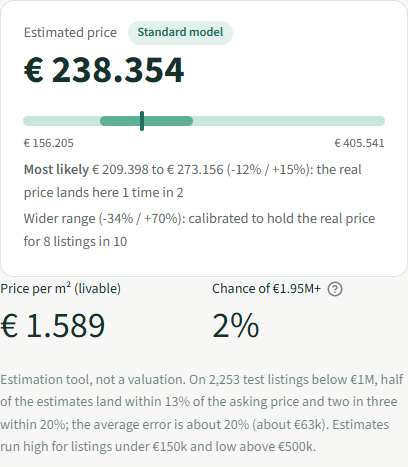
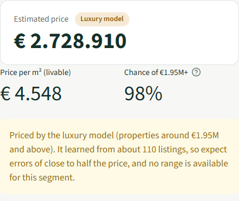

# Immo Eliza Deployment

Give it a Belgian house or apartment and it gives back an asking-price estimate, the range the price most likely falls in, and a warning when the property looks like luxury. On 2,361 listings it never saw, half the estimates land within 13% of the asking price and two in three within 20%.

XGBoost pipelines behind a FastAPI service, a Streamlit form in front, Docker images built and scanned in CI, and a drift report on the prediction log.



- Web app: https://immo-eliza-deployment-sieg.streamlit.app
- API (Render, free tier, sleeps when idle: the first call can take a minute): https://immo-eliza-deployment-j8av.onrender.com/docs
- Docker Hub: [`siegried/immo-eliza-api`](https://hub.docker.com/r/siegried/immo-eliza-api), [`siegried/immo-eliza-ui`](https://hub.docker.com/r/siegried/immo-eliza-ui)

How it works, why, and what is still weak: [docs/technical_deep_dive.md](docs/technical_deep_dive.md). Dated decisions that changed what a number means: [docs/decisions.md](docs/decisions.md).

## Run it

```bash
docker compose up --build      # UI http://localhost:8508, API docs http://localhost:8008/docs
```

Pre-built images instead of a build: [DOCKERHUB.md](DOCKERHUB.md). Without Docker (Python 3.12; the pinned scikit-learn and numpy need 3.12 or later):

```bash
pip install -r requirements.txt
uvicorn api.app:app --port 8008                                              # terminal 1
API_URL=http://localhost:8008 streamlit run streamlit/app.py --server.port 8508   # terminal 2
```

Retrain and re-evaluate (needs `data/clean/cleaned_data.json`, which is not in git). Every command runs from the repository root, as a module:

```bash
python -m src.train                          # the five models, models/luxury_threshold.json, interval_calibration.json
python -m scripts.export_categories          # models/categories.json
python -m scripts.evaluate_stratified --test # deployed pipeline on the sealed test split, per price tier
python -m monitoring.metrics                 # standard model alone, per price tier
```

Other tools: `scripts.evaluate_routing_blend` (threshold vs probability blends), `scripts.predict_cli` (terminal predictions through the API's schema and routing), `monitoring.generate_logs` then `monitoring.check_drift monitoring/synthetic_logs.jsonl` (drift report on synthetic traffic).

## API

```bash
curl -X POST http://localhost:8008/predict -H "Content-Type: application/json" \
  -d '{"postcode": 4000, "province": "Liège", "city": "Liège", "property_type": "HOUSE", "livable_surface": 150}'
```

```json
{"prediction": 241483.8, "prediction_interval": {"lower": 165809.59, "upper": 444402.41},
 "likely_range": {"lower": 212147.39, "upper": 276743.37}, "currency": "EUR",
 "status": "success", "segment": "standard", "luxury_probability": 0.024, "notes": []}
```

Required: `postcode`, `province`, `city`, `property_type` (`HOUSE` or `APARTMENT`), `livable_surface`. Every other field is optional, and a field left out is treated as missing, as in training, never as 0. Categories are accepted in French, Dutch or English, in any case. An unknown province or type gives a 422; an unknown city is accepted and reported in `notes`. `prediction_interval` is the range that holds the price 8 times in 10, `likely_range` the narrower one that holds it 1 time in 2; both are null for the luxury segment. `GET /ping` is the liveness probe.

## Structure

```text
api/          FastAPI app and the inference engine
streamlit/    web UI
src/          features.py (one feature pipeline for training and serving), train.py, optimize.py
models/       the five pickled pipelines and their JSON companions (threshold, calibration, categories, locations)
monitoring/   prediction log, PSI drift report, test-split metrics
scripts/      evaluation, export and publishing tools
docs/         technical deep dive, README screenshots
tests/        offline pytest suite
```

## Configuration

| Variable | Used by | Default |
|---|---|---|
| `PORT` | API and UI images, `python -m api.app` | 8000 (API), 10000 (UI) |
| `API_URL` | UI: where the API answers | `http://localhost:8000` |
| `API_DOCS_URL` | UI: the documentation link (empty hides it) | `$API_URL/docs` |
| `PREDICTION_LOG_PATH` | API: where predictions are logged (JSON Lines) | `monitoring/logs.jsonl` |
| `DOCKERHUB_USERNAME` | `docker-compose.yml` image names | `siegried` |

`.env.example` lists them. Compose publishes the API on host port 8008 and the UI on 8508 (container ports 8000 and 10000).

## Prediction Examples

- House, 150 m², Liège 4000, normal condition, form defaults otherwise: €238,354 from the standard model, most likely €209,398 to €273,156, wider range €156,205 to €405,541.
- House, 600 m² on 3,000 m² of land, Uccle 1180, excellent condition, 7 bedrooms, garage, terrace, pool: €2,728,910 from the luxury model (probability 98%).
  

## Performance

Measured on a sealed test split of 15% of the listings, which nothing was fitted, tuned or chosen on (`python -m scripts.evaluate_stratified --test`).

| Deployed pipeline, routing at 0.9 | |
|---|---:|
| Mean absolute percentage error | 20.3% (19.8% below €1M), 95% CI 19.1% to 21.6% |
| Median error | 12.9% |
| Estimates within 10% / 20% of the asking price | 40% / 66% |
| 10th to 90th percentile range holds the real price | 80.4% of the 2,344 standard-segment listings |
| "Most likely" band (about -12% / +15%) holds it | 50.1% of them (target 50%) |

The confidence interval is a bootstrap over the test rows. Drawing the split with other seeds moves the standard model's MAPE between 20.2% and 21.4%, so read the error as about 20 to 21%, and treat any change under a point as noise. The range holds the price less often where the model is weakest: about 74% for estimates above €500k, and no range at all in the luxury segment.

Details by price tier, the range calibration and the luxury routing are in the [deep dive](docs/technical_deep_dive.md#4-luxury-routing).

## Limits

- An estimation tool, not a valuation. Every estimate in the UI carries a disclaimer.
- Estimates run high under €150k and low between €500k and €1M: the model pulls prices towards the middle of the market.
- Above about €1.95M the error is close to half the price, mostly underestimation: the luxury model learned from 111 listings.
- The location is the centroid of the postcode's training listings, not the street. A city name outside the training vocabulary is ignored, and the response says so.
- The prediction log does not survive a Render restart unless `PREDICTION_LOG_PATH` points at a persistent disk, so no drift report on real traffic exists yet.
- The data is one scrape of asking prices, not sale prices. It was collected once from Immovlan for a training project and is not redistributed. Don't use it commercially.
- 155 of the 2,361 test listings share an address with a training listing. On a building the models never saw, the error is about 0.7 point higher.
- Accuracy differs by region: the mean error is about 15% in Antwerp and Walloon Brabant and 27% to 30% in West Flanders and Hainaut. The direction does not: no province is consistently over- or underestimated.
- Not for lending, credit or any decision about a person. The models read the postcode, so they reproduce local price patterns, and the error is far too wide for an underwriting use.

## Tests and CI

```bash
pip install -r requirements.txt -r requirements-dev.txt
ruff check . && python -m pytest
```

The suite is offline (the UI tests mock the API). GitHub Actions lints and tests every pull request and every push to `main` (`tests.yml`), and `publish.yml` builds, smoke-tests and scans both images before pushing them to GHCR and Docker Hub. The `.joblib` models are committed (14 MB) and pickled: the pins in `requirements.txt` must match the versions they were trained with.

## Author

Siegried Camus, BeCode AI & Data Science bootcamp.
